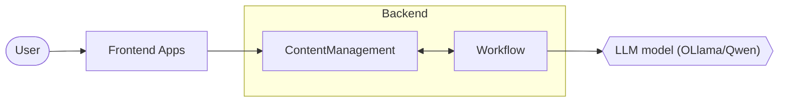

# Bếp Phương Bắc

A simple app that reads orders from a channel like Zalo and creates/manages orders for skillful master chefs who want a perfect meal for their customers.

## Quick start

### Prerequisites

| Tool | Needed for | Install |
|---|---|---|
| Node.js 22+ | everything | https://nodejs.org or `nvm install 22` |
| pnpm 10 | everything (version pinned by `packageManager`) | `corepack enable` (ships with Node) |
| Docker (with Compose) | backend | https://docs.docker.com/get-docker/ |
| make, k6 | backend seed and tests | `brew install k6` / https://k6.io |

### Architecture



### Run

```sh
make dev
```

Installs JS dependencies, starts the backend and PostgreSQL, then both frontends. Open http://localhost:5173/#/order and sign in as `kitchen` / `Kitchen123!dev` (Orchard admin at http://localhost:5080/admin, `admin` / `Admin123!dev`).

Other commands: `make stack-up` (no frontends), `make llm-up` (local model, multi-GB), `make stub-up` (test LLM stub), `make test-backend`, `make stack-down` (drops the database). Backend details, the pre-order workflow and its configuration are in [backend/README.md](backend/README.md).

## Engineering guidelines

The full rules are in [AGENTS.md](AGENTS.md). Summary of what a change must satisfy:

### Repository layout

| Path | What |
|---|---|
| `apps/shell` | Micro-frontend host (router, mediator, remote loader), dev port 5173 |
| `apps/orders` | Orders micro-frontend (`<orders-app>` web component), dev port 5174 |
| `apps/e2e` | Playwright end-to-end tests against the real stack ([README](apps/e2e/README.md)) |
| `packages/contracts` | Shared contracts between shell and remotes |
| `backend/` | Orchard Core + PostgreSQL via Docker ([README](backend/README.md)) |
| `backend/Bpb.Workflows.Llm` | Reusable Orchard workflow module: the generic "LLM Extract" activity (Microsoft.Extensions.AI client), with its tests in `backend/Bpb.Workflows.Llm.Tests` |
| `specs/`, `docs/` | Specs and architecture notes |

### 1. Standards first
- Use standard protocols over bespoke abstractions: HTTP semantics (RFC 9110), Problem Details errors (RFC 7807), OAuth 2.0 / OIDC / PKCE / JWT, OpenAPI 3.x, CloudEvents.
- Never return `200 OK` with an error payload. Use `Idempotency-Key` where it applies.
- Configuration and credentials come from the environment, never from source (12-factor). Dev-only placeholders live in `backend/.env.example`.
- Database changes are version-controlled, forward-only migrations. No ad-hoc DDL.
- Use named resilience patterns (timeouts, backoff retries, circuit breakers), not hand-rolled retry loops.

### 2. Change scope
- Keep each change as small as possible, but a complete vertical slice (controller, service, repository, DB) within one bounded context.
- Never reach into another context's domain logic, repositories or tables. Integrate through published contracts (OpenAPI REST or CloudEvents).
- Split multi-context features into one change per context.
- Before merging, check that it works end to end, touches one bounded context, and crosses contexts only through published contracts.

### 3. Observability, tests and modularity
- Propagate W3C `traceparent` across every external entrypoint, emit structured JSON logs with `trace_id` and `span_id`, and export metrics (invocations, latency, errors) over OTLP or Prometheus.
- Every feature, bug fix and refactor needs automated tests: happy path, edge cases, errors, timeouts and telemetry propagation. Mock only at external boundaries.
- Keep modules single-purpose (`config`, `auth`, `client`, `domain`, `server`, `telemetry`, `cli`) with dependencies flowing one way and no cycles. Use facades to keep contracts stable when refactoring.

### Checks before you push

```sh
pnpm typecheck
pnpm test                       # unit tests, all packages
pnpm build

# end-to-end, real stack (needs `make stack-up` first)
pnpm --filter @bpb/e2e exec playwright install chromium   # once
pnpm --filter @bpb/e2e e2e:headed   # visible browser
pnpm --filter @bpb/e2e e2e          # headless
make test-backend                   # k6 integration + pre-order pipeline tests (uses llm-stub)
dotnet test backend/Bpb.Workflows.Llm.Tests   # LLM Extract activity unit tests
```

The pre-order e2e test (`preorder-pipeline.spec.ts`) needs the stub as LLM: run `make stub-up` right before `e2e`, because `make test-backend` ends by restoring the default endpoint.

CI (`.github/workflows/ci.yml`) runs typecheck, tests and build, then the backend stack, k6 tests, the adapter contract test and Playwright. Tests should exercise the same interfaces used in production (REST, OIDC).

### Where things are specified
- Feature specs: [specs/](specs/). Known gaps and open decisions (observability not built, PKCE `plain`, hosting, per-chef accounts and others) are in [specs/2026-11-20-backend-order.spec.md](specs/2026-11-20-backend-order.spec.md#implementation-status-slices-14-and-e2e-built-2026-11-20).
- Micro-frontend host flow: [docs/micro-frontend-host-main-flow.md](docs/micro-frontend-host-main-flow.md).
- Backend configuration, endpoints and sign-in: [backend/README.md](backend/README.md).

### Troubleshooting

- **Blank page or remote fails to load**: the orders dev server (5174) is not running.
- **Sign-in redirect or CORS errors**: the ports differ from 5173/5174. Set `UI_REDIRECT_URIS` and `CORS_ALLOWED_ORIGINS` in `backend/.env` (see [backend/README.md](backend/README.md)), then `make stack-down && make stack-up`. Both are read only when the tenant is first created.
- **Port 5080 or PostgreSQL in use**: stop the other process, or `make stack-down` to clear a stale stack.
- **`k6: command not found`**: `brew install k6`.

### Deploy

`pnpm build`, then copy `apps/orders/dist/orders-app.js` to `apps/shell/dist/remotes/orders/` (CI does this). `host.config.prod.json` loads `./remotes/orders/orders-app.js`.
