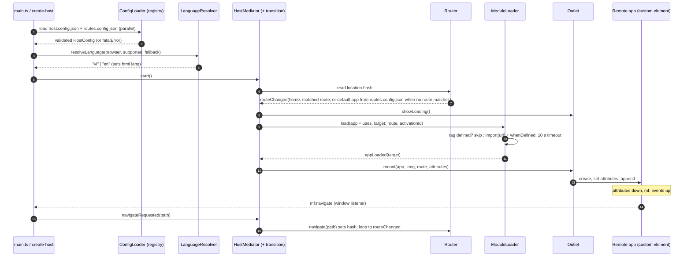
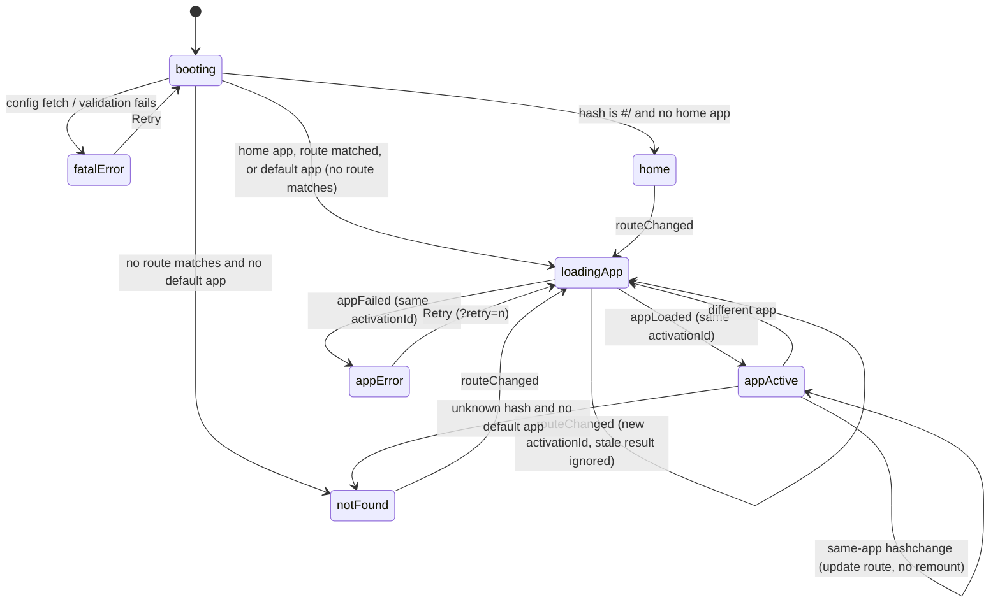

# Shell Main Flow (v1)

Source: [specs/2026-11-19-micro-frontend-host.spec.md](../specs/2026-11-19-micro-frontend-host.spec.md), "Runtime flow" and "Host internals (Mediator pattern)".

## 1. Startup and first route (happy path)

## 2. Route phases (mediator state)

Child (`uses`) failures never change the phase. They only log a warning, and the parent renders its own fallback.
