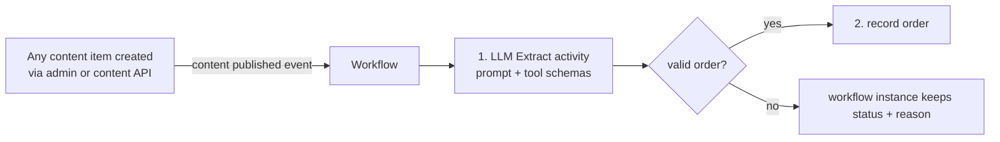
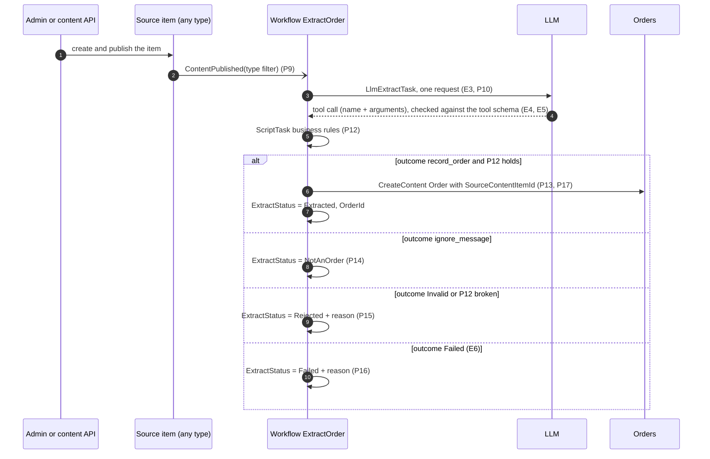
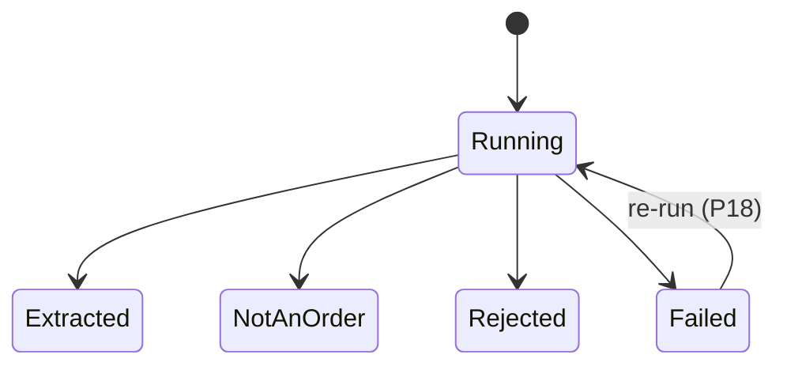

# Process Pre-order Messages (content created → workflow → LLM → order)

Status: **Draft, needs review of the open decisions** · Owner: orders bounded context · Builds on: [2026-11-20-backend-order.spec.md](2026-11-20-backend-order.spec.md)

## Idea

The backend is a SaaS that already supports a workflow engine (Orchard Core Workflows). So we build an order-extraction pipeline. A content item of any type (the sample is `ChannelMessage`) is created through the Orchard admin or the content API, and that event starts the workflow:



## Goal

Turn a free-text chat message ("chị đặt 3 phần cơm gà cho mai, giao trước 11h"), once it exists as a `ChannelMessage`, into an `Order` the kitchen sees in the orders app, with no human typing of the order. Own as little code as possible: the workflow engine does the orchestration, and we write only what it cannot do: one generic, reusable workflow activity that extracts structured data with an LLM. The activity takes a content-created event as input, lets the workflow author map and configure the prompts, and lets them define the tool-call schemas that shape the extracted result. Everything order-specific is workflow configuration, not C#.

## Non-goals

- **Receiving messages from a channel** (webhook, Zalo or any other). Messages enter as content created through the Orchard admin or the content API, which is also how the workflow and activity are validated.
- Replying to the customer, confirming the order, or any outbound message.
- Editing or cancelling an existing order from a later message.
- Changing the orders app UI or the `OrdersApi` seam. Orders created here appear through the existing read path.
- Training or fine-tuning a model, and a human review UI beyond the Orchard admin.
- Attachments, images, voice and multi-language support beyond Vietnamese and English text.
- Multi-tenant Orchard, and production hosting (open decision D5 of the backend spec).

## Users and stories

| ID | Story |
|---|---|
| US9 | As the owner, a customer's message that I (or later a channel) add as a `ChannelMessage` becomes a pre-order in the kitchen's list, without anyone retyping it. |
| US10 | As the owner, a message that is not an order, or has no usable quantity or date, never creates a bad order, and I can see it and why in the admin. |
| US12 | As an operator, I can see in the admin every run, its status and the reason for a failure, and re-run a failed one. |
| US14 | As a workflow author, I can add an "LLM Extract" step to any workflow, triggered by a content-created event, map the content into the prompt, define the tool-call schemas that describe the data I want, and get structured data back, without writing code. |
| US13 | As a security owner, the LLM key never appears in source or logs. |

## Requirements (EARS)

Systems: **message store** (`ChannelMessage` content), **workflow** (`ExtractOrder`), **extractor** (the LLM call and its validation) and **orders** (the existing `Order` type). 

### Workflow and extraction (US9, US10)

| ID | Type | Requirement |
|---|---|---|
| P9 | Event | When a content item of the type chosen in the workflow's start event is created and published, whether from the Orchard admin or through the content API (Orchard's standard "Content Published" event; the type filter is a setting of the workflow, so any content type can be the source), the `ExtractOrder` workflow shall start for it, and its first step shall be the `LlmExtractTask`. The source item is called the **message** below, whatever its type. |
| P10 | Event | When it starts, the workflow shall run one `LlmExtractTask` (E3) whose System prompt states today's date in `Asia/Ho_Chi_Minh` (Liquid `{{ "now" | local | date: "%Y-%m-%d" }}`) and asks the model to call exactly one tool, and whose User prompt, a Liquid template, converts the source item into the single user message (for example `{{ ContentItem.Content.ChannelMessage.Text.Text }}` for the sample type, or any other field expression for another type). Two tools are defined: `record_order` (`customerName`, `qty`, `serviceDate` as `YYYY-MM-DD`, optional `note`) when the message is a pre-order, and `ignore_message` (`reason`) when it is not. |
| P11 | Ubiquitous | The LLM output shall be treated as untrusted input: the tool schemas (E4, E5) check its shape, and the business rules below check its values. |
| P12 | Ubiquitous | A `ScriptTask` after the activity shall accept the arguments of `record_order` as a valid order only if `customerName` is non-empty (at most 200 characters), `qty` is an integer from 1 to 999, and `serviceDate`, when present, is a real calendar date that is today or later (when absent, today is used, D5). |
| P13 | Event | When the activity takes the outcome `record_order` and P12 holds, the workflow shall create and publish one `Order` with `Delivered` false, `Message` set to the original text, the extracted fields and a `SourceContentItemId` (the source item's id), assign `No` in the way the workflow designer chooses ([D3](#open-decisions); the activity takes no part in it), and set the workflow property `ExtractStatus` to `Extracted` and `OrderId` to the new order's id. |
| P14 | Event | When the activity takes the outcome `ignore_message`, the workflow shall set `ExtractStatus` to `NotAnOrder` and create nothing. |
| P15 | Event | When the activity takes the outcome `Invalid` (E5) or the `record_order` arguments break P12, the workflow shall set `ExtractStatus` to `Rejected` and `ExtractReason` to a short reason, and create nothing. |
| P16 | Unwanted | If the activity takes the outcome `Failed` (E6; timeout is `Bpb:Llm:TimeoutSeconds`, default 120), then the workflow shall set `ExtractStatus` to `Failed` and `ExtractReason` to a reason, create nothing and not loop. |
| P17 | Ubiquitous | The workflow shall create at most one order per source item, even if the workflow runs again for it (P18): before creating, it checks that no `Order` with that `SourceContentItemId` exists. |
| P18 | Optional | Where an operator re-runs a source item whose last run ended `Failed`, from the admin (re-publish the item or start the workflow again), the workflow shall process it again from the start. |
| P19 | Ubiquitous | The outcome is recorded on the workflow instance, never written back to the source item (it can be any content type). `ExtractStatus` is one of `Extracted`, `NotAnOrder`, `Rejected`, `Failed`; each run ends in exactly one, and a re-run (P18) may end in any of them. The operator sees them in the admin's workflow instances (US12). |

### Configuration, security and operations (US12, US13)

| ID | Type | Requirement |
|---|---|---|
| P20 | Ubiquitous | The LLM settings of E7 shall come from configuration and never from source. Dev-only placeholders live in `backend/.env.example`. |
| P22 | Ubiquitous | The schema (the `Order.SourceContentItemId` addition and the sample source type `ChannelMessage`, see Data) and the `ExtractOrder` workflow shall be created by the recipe at first start, not by clicks in the admin (Principle 1.4). |
| P23 | Ubiquitous | Each source item shall be traceable end to end: the workflow run and the order shall log the same `SourceContentItemId` as a structured field, with `trace_id` and `span_id` when tracing is on. |
| P24 | Ubiquitous | The system shall expose counters for source items processed and per-status outcomes, and a histogram of extraction latency, when OpenTelemetry is wired (backend spec slice 5, gap G1). Until then P23 logs are the minimum. |
| P25 | Ubiquitous | The `Kitchen` role shall not be able to read or write the sample source type `ChannelMessage`, or manage workflows. |

## Architecture

### Layout and bounded context

One bounded context: **orders** (the same backend host). The message store and workflow live in it. Messages enter through Orchard's own admin and content API.

```
backend/Bpb.Workflows.Llm/            # NEW module (E1..E11), reusable
  Bpb.Workflows.Llm.csproj
  Manifest.cs                       # [assembly: Module(...)], Dependencies: OrchardCore.Workflows
  Startup.cs                        # AddActivity<LlmExtractTask, LlmExtractTaskDisplayDriver>(), typed HttpClient
  Activities/LlmExtractTask.cs
  Drivers/LlmExtractTaskDisplayDriver.cs   # editor for E2
  Views/LlmExtractTask*.cshtml
  Client/ILlmClient.cs, ChatCompletionsClient.cs   # E3, E8 (one request, no retry)
  Options/LlmOptions.cs             # E7
backend/Bpb.Workflows.Llm.Tests/    # NEW xUnit: activity outcomes with a fake ILlmClient, client against llm-stub
backend/Bpb.Backend/               # references Bpb.Workflows.Llm; no new C# of its own
  Recipes/BpbOrders.recipe.json     # + sample ChannelMessage type, Order.SourceContentItemId field, ExtractOrder workflow, enable Bpb.Workflows.Llm
backend/k6/                         # + activity and pipeline integration tests (messages created through the content API)
backend/llm-stub/                   # NEW: tiny stub of the LLM endpoint for tests (returns canned tool calls) (test compose profile)
```

### End-to-end flow



Outcome of one workflow run (P19), kept on the workflow instance, never on the source item:



Orchard Core already provides the script task, branching and content tasks. We configure them in the recipe. The one thing it lacks is a typed, schema-checked LLM step, so we add it as a generic activity (E1 to E11) instead of hand-building HTTP and JSON parsing inside every workflow. The activity's outcomes are the workflow's branches: one per tool (`record_order`, `ignore_message`), plus `Invalid` and `Failed`.

### Data

**The source item can be any content type.** Neither the activity nor the workflow requires a dedicated message schema: the workflow's start event picks the type, and the Liquid User prompt (P10) converts that item into the text sent to the LLM. For the recipe, tests and the demo we ship one **sample** type, `ChannelMessage` (not listable by `Kitchen`), with `Channel`, `SenderName`, `Text` and `SentAt` and no status fields. Status, reason and order link live on the workflow instance (P19), not on the item. 

`Order` gets one additive field, `SourceContentItemId` (text, the id of the item it was extracted from; it is how P17 finds an existing order). Existing fields, the GraphQL shape and the orders app are unchanged (additive-first).

### LLM call

`LlmExtractTask` sends a request to a **local Qwen model served by Ollama**, through its OpenAI-compatible Chat Completions endpoint (`POST {Bpb:Llm:Endpoint}/v1/chat/completions`, default `http://ollama:11434`), so any compatible server can replace it by configuration. The request has the System prompt as the system message, tool calling (`tools`, `tool_choice: required`), temperature 0, and the untrusted text as the only user content. It is a single shot: the tool is never run, no tool result is sent back, no retry and no follow-up turn (E3). The model id is configuration, defaulting to `qwen2.5:7b-instruct`. The Ollama service is added to the compose stack (CPU works; a GPU is optional) and the model is pulled once by a `make` target. Small local models make more extraction mistakes than hosted ones, which is why P12 validates every field and D5 rejects rather than guesses. Relative dates ("mai", "thứ sáu") are resolved by the model against the date given in the prompt, then validated by P12.

### Alternatives considered

| Option | Why not |
|---|---|
| A separate ingestion microservice | A second deployable and a cross-context contract for no gain in one bounded context. |
| JSON-mode output (`response_format`) instead of tool calls | Works too, but cannot express "order or not an order" as two typed branches without an `isOrder` flag, and tool calling is the standard way to get typed, named results. |
| `HttpRequestTask` + `ScriptTask` per workflow | Repeats request building, parsing, timeout and error handling in every workflow, hard to test. The generic activity is the same lower-layer HTTP call, written once (E8). |
| LLM called from C# code, no workflow | Throws away the workflow engine the idea starts from, and the admin visibility of runs (US12). |
| Rule-based parsing, no LLM | Free-text Vietnamese orders are the reason for the LLM. |

## Known risk

Anyone who may publish a `ChannelMessage` (an admin, or a client holding a token with that permission) triggers an LLM call (CPU or GPU time on the local model) and may create an order. Message creation is protected by the backend's existing OpenID authorisation and roles, and `Kitchen` has no access (P25).

## Testing

Tests exercise the same interfaces as production: HTTP, OpenID and GraphQL (Principle 3.2). The LLM is the only mocked external boundary, through `llm-stub` selected by `Bpb:Llm:Endpoint`.

| Level | What | Tool |
|---|---|---|
| Unit (`Bpb.Workflows.Llm.Tests`) | E3 to E8: request shape (one call, system and user messages, tools, `tool_choice` required), one outcome per tool, `Invalid` for no tool call, unknown tool and bad arguments, `Failed` for timeout, 500, empty, unparseable, unset endpoint; settings override; no retry; no log of prompts; the same activity renders prompts from two different content types and from a non-content workflow (E10) | xUnit with a fake `ILlmClient` and a fake `HttpMessageHandler` |
| Pipeline (k6 + `llm-stub`) | P9 to P19: a `ChannelMessage` created through the content API (the same path as the admin; a second test uses a different content type to show the source is any type) gives an order, not an order, invalid qty, past date, LLM 500, LLM timeout, garbage reply, prompt-injection text that tries to set `qty`, replay of a `Failed` message creates one order | `make test-backend` |
| Authorisation | `Kitchen` token gets `403` on the sample `ChannelMessage` type and on workflows (P25) | k6 |
| E2E | A message created through the content API appears as an order in the orders app list for its service day | Playwright (existing `apps/e2e`) |


## Acceptance criteria

1. A `ChannelMessage` created through the admin or content API with the text "3 phần cơm gà cho ngày mai, tên chị Lan" results, within the configured LLM timeout, in an `Order` (name Lan, qty 3, tomorrow's date, `Delivered` false) that shows in the orders app.
2. "Hôm nay trời đẹp quá" ends as `NotAnOrder`, a message with qty 0 or a past date as `Rejected`, and neither creates an order.
3. With the LLM down, the message ends as `Failed` with a reason, and re-running it after the LLM is back creates exactly one order.
4. No secret or message text appears in container logs.
5. `make stack-up` from a clean checkout provisions everything with no admin clicks.

## Delivery slices

Each slice is vertical within the orders context and ends with passing tests.

| # | Slice | Contents | Depends on |
|---|---|---|---|
| 0 | **Spike** | Verify on OC 3.0.1 the items in [Not verified](#not-verified). Amend this spec with findings. No production code. | none |
| 1 | **Schema** | `Order.SourceContentItemId` and the sample source type `ChannelMessage` in the recipe, `Kitchen` denied on it and on workflows, Workflows features enabled (and `Bpb.Workflows.Llm` once slice 2 lands), k6 test (P22, P25) | 0 |
| 2 | **LLM Extract activity** | Module `Bpb.Workflows.Llm` (E1 to E11), `llm-stub`, config and `.env.example` (P20), unit tests, one k6 test running a tiny workflow through the activity | 0, 1 |
| 3 | **Extract** | `ExtractOrder` workflow in the recipe, pipeline tests (P9 to P19), `No` assignment as the workflow designer chooses (D3) | 1, 2 |
| 4 | **Operate** | Structured log fields, retry procedure from the admin, README section, e2e test (P23 logs) | 3 |
| 5 | **Metrics** | Counters and histogram once slice 5 of the backend spec lands (P24) | backend G1 |

## Not verified

These are assumptions about Orchard Core 3.0.1 that slice 0 must run before anything is built:

1. `OrchardCore.Workflows` (with the HTTP, scripting and contents activities) can be enabled and a workflow defined from a recipe step, and it starts on `ContentPublished` of a given type.
2. A custom activity can be registered from a host-referenced module on OC 3.0.1 (`AddActivity<,>`, a display driver and Razor views found without extra packaging), shows in the editor, has several outcomes, and can read and write workflow properties and evaluate Liquid or JavaScript expressions for its settings.
3. A `ScriptTask` can parse JSON, validate (P12) and branch, and `CreateContentTask` / `UpdateContentTask` can write the fields listed above, including the `OrderId` link.
4. A workflow triggered from a content event runs when the content is created through the content API (not only from the admin), and the "Content Published" event can be filtered to one content type.
5. A `Failed` message can be re-run from the admin, or by republishing, without creating a second order (P17, P18).
6. A task failure inside the workflow can be routed to the `Failed` branch rather than leaving the run faulted.
7. Informational only (D3 is the workflow designer's choice): report what `No` assignment options the workflow engine allows and whether concurrent runs can race.
8. Ollama's `/v1/chat/completions` with `tools` and `tool_choice: required` returns a correct `record_order` or `ignore_message` call for Vietnamese order text on `qwen2.5:7b-instruct` (Qwen 2.5 supports tool calling; check that `required` is honoured, else use a fallback of one forced tool), within the timeout on the target machine, and the activity can call it from the backend container.

If 1, 3 or 4 fail, the fallback is to host the extraction step in C# behind the same content-published event, and this spec is amended before slice 2.

## Open decisions

| # | Decision | Options | Recommendation |
|---|---|---|---|
| D1 | **LLM provider and model.** Decided by the owner: a local Qwen model. | Qwen via Ollama (chosen); llama.cpp or vLLM serve the same API. | `qwen2.5:7b-instruct` on Ollama. Check Vietnamese extraction quality on real messages in slice 0 and move to a larger Qwen if it is poor. |
| D2 | **One order or many per message.** A message can list several people or dishes. | One order per message (this spec) or an array. | **Decided:** one for v1; a multi-order message is `Rejected` with reason `multiple`. Revisit with real data. |
| D3 | **How `No` is assigned.** The kitchen list sorts by `No`, one per service day starting at 1. | Script computes `max+1` for the day (race possible), or a per-day counter, or serialised workflow runs. | **Decided by the owner:** the workflow designer chooses, inside the workflow. The activity is generic and takes no part. The spike (item 7) reports the options; the choice is documented in the README. |
| D5 | **Missing date.** A message with no date. | Reject, or default to today, or default to tomorrow. | **Decided (revised 2026-11-21 by the owner):** ignore the missing date and use today (Asia/Ho_Chi_Minh). Originally: reject with reason `no date`. An invalid or past date is still rejected. |
| D6 | **Personal data.** Customer names and messages are stored in our database and processed by a local model, so nothing leaves our infrastructure. | None needed for the LLM. | Resolved by D1; still document retention of source items and workflow instances (D7). |
| D7 | **Retention of source items and workflow instances.** | Keep forever, or purge after N days. | **Decided:** keep for the pilot. |
| D8 | **Who may re-run a failed message.** | Admin only, or a `Kitchen` action. | **Decided:** admin only (P25). |
